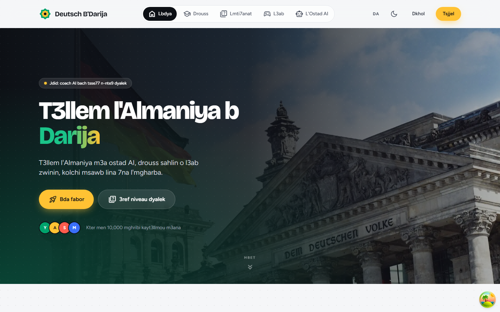
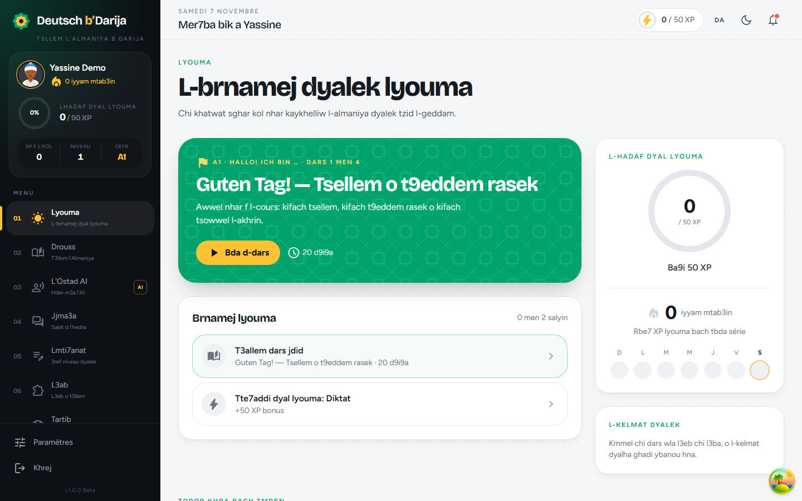
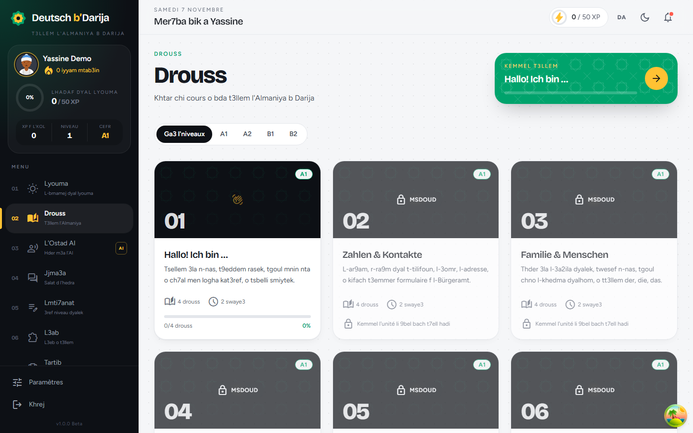
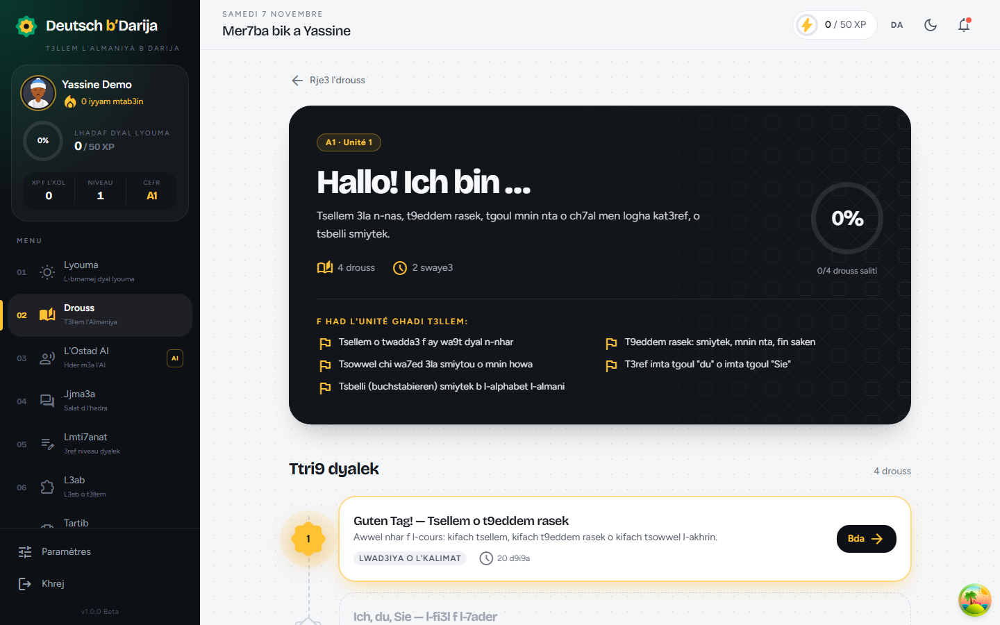
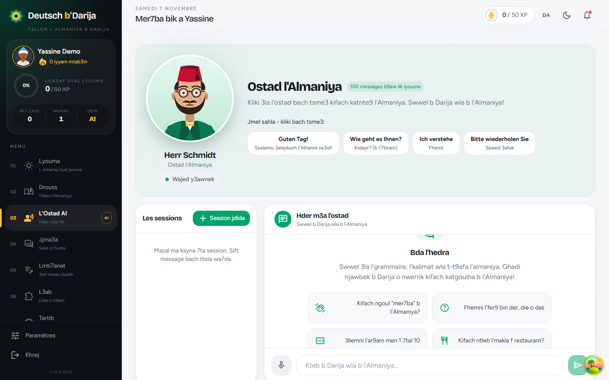
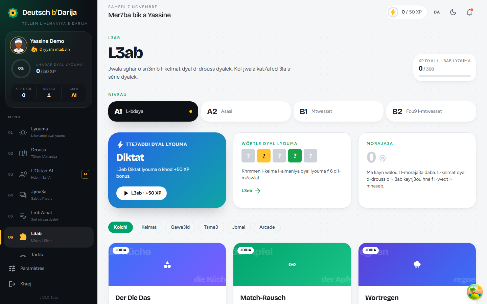
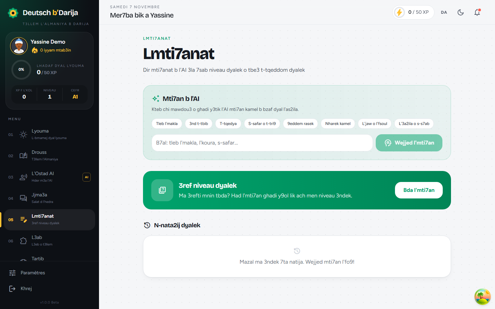
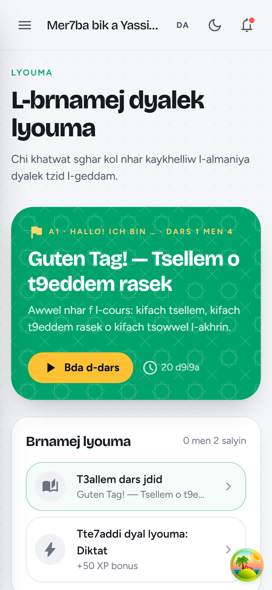
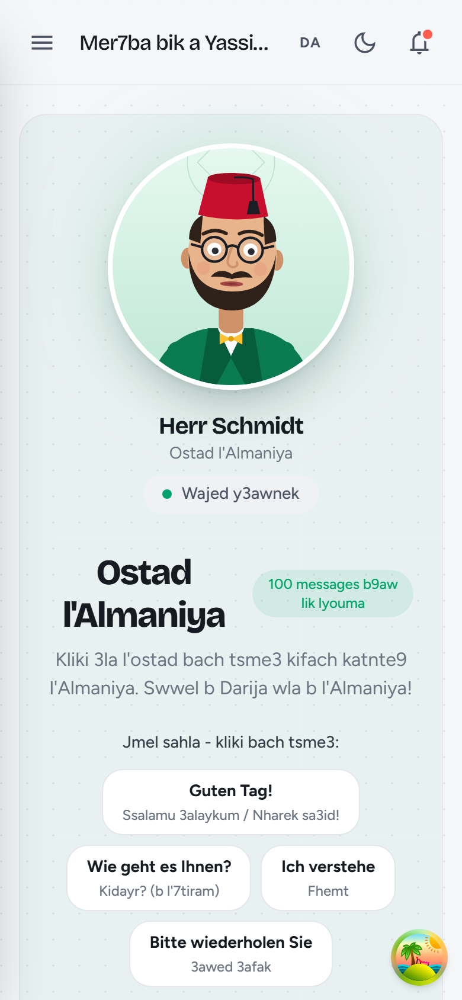

# 🇩🇪🇲🇦 أستاذ الألمانية بالدارجة — Darija German Teacher

A RAG-powered app that teaches German in Moroccan Darija (الدارجة المغربية). Upload German learning PDFs and ask questions — the AI teacher explains everything in Darija!


## Screenshots



| Today — daily plan | Courses |
| --- | --- |
|  |  |
| **Course unit** | **AI teacher (Herr Schmidt)** |
|  |  |
| **Games** | **Tests** |
|  |  |

<p align="center">
  
  &nbsp;&nbsp;
  
</p>

---

## Architecture

```
┌─────────────┐     ┌──────────────────┐     ┌──────────────────┐
│  PDF Files   │────▶│  PDF Processor    │────▶│  Text Chunks     │
│  (German     │     │  (PyMuPDF)        │     │  (800 chars,     │
│   textbooks) │     │  Extract + Clean  │     │   150 overlap)   │
└─────────────┘     └──────────────────┘     └────────┬─────────┘
                                                       │
                                                       ▼
┌─────────────┐     ┌──────────────────┐     ┌──────────────────┐
│  User Query  │────▶│  Embedding Model  │────▶│  ChromaDB        │
│  (Darija/    │     │  (multilingual    │     │  Vector Store    │
│   German/FR) │     │   MiniLM)         │     │  (cosine search) │
└─────────────┘     └──────────────────┘     └────────┬─────────┘
                                                       │
                                                       ▼
                                             ┌──────────────────┐
                                             │  Claude API       │
                                             │  + Darija System  │
                                             │    Prompt         │
                                             │  → Response in    │
                                             │    Darija! 🇲🇦     │
                                             └──────────────────┘
```

## Quick Start

### 1. Clone & Install

```bash
cd darija-german-teacher

# Create virtual environment (recommended)
python -m venv venv
source venv/bin/activate  # Linux/Mac
# venv\Scripts\activate   # Windows

# Install dependencies
pip install -r requirements.txt
```

### 2. Set your API Key

```bash
# Copy the template
cp .env.example .env

# Edit .env and add your Anthropic API key
# Get one at: https://console.anthropic.com/
export ANTHROPIC_API_KEY="sk-ant-your-key-here"
```

### 3. Ingest your first PDF

```bash
# Place your PDF in data/pdfs/ then:
python ingest.py

# OR ingest a specific PDF from anywhere:
python ingest.py /path/to/Basic_german.pdf

# To clear and re-ingest everything:
python ingest.py --clear
```

### 4. Launch the App

```bash
streamlit run app.py
```

Open **http://localhost:8501** — start asking questions in Darija! 🎉

---

## Adding More PDFs

You can add more PDFs anytime:

**Option A — Via the UI:**  
Use the sidebar upload button in the Streamlit app. It processes and indexes automatically.

**Option B — Via command line:**
```bash
# Drop the PDF in data/pdfs/
cp new_german_book.pdf data/pdfs/

# Re-run ingestion
python ingest.py
```

The system only adds new chunks (it won't duplicate existing ones).

---

## Project Structure

```
darija-german-teacher/
├── app.py                  # Streamlit web interface
├── ingest.py               # CLI tool to process PDFs
├── requirements.txt        # Python dependencies
├── .env.example            # API key template
├── rag_core/
│   ├── __init__.py
│   ├── pdf_processor.py    # PDF → text → chunks
│   ├── vector_store.py     # ChromaDB embeddings & search
│   └── rag_chain.py        # RAG pipeline + Darija prompt
└── data/
    ├── pdfs/               # Your German PDF files
    └── vectordb/           # ChromaDB persistent storage
```

---

## Key Design Decisions

| Component | Choice | Why |
|-----------|--------|-----|
| **Embeddings** | `paraphrase-multilingual-MiniLM-L12-v2` | Supports Arabic, German, English, French — perfect for Darija queries about German content |
| **Vector Store** | ChromaDB (persistent) | Simple, no server needed, persists to disk |
| **Chunking** | 800 chars, 150 overlap | Good balance for grammar explanations |
| **LLM** | Claude Sonnet | Great multilingual + instruction following |
| **UI** | Streamlit | Fast to build, supports file upload, chat UI |

---

## Example Questions

| Question | What it does |
|----------|-------------|
| `كيفاش نقول "أنا كنقرا الألمانية" بالألمانية؟` | Translates and explains sentence structure |
| `شرحلي der, die, das` | Explains German articles in Darija |
| `شنو هي الأفعال المنفصلة؟` | Explains separable verbs with examples |
| `كيفاش نكوّن الماضي؟` | Teaches past tense (Perfekt) |
| `عطيني حوار فالمطعم` | Generates a restaurant dialogue |

---

## Customization

### Change the teaching style
Edit the `SYSTEM_PROMPT` in `rag_core/rag_chain.py` to adjust:
- Formality level
- How much French to use for comparisons
- Whether to include pronunciation tips
- Adding quiz/exercise generation

### Adjust chunking
In `rag_core/pdf_processor.py`, modify `chunk_size` and `chunk_overlap` if your PDFs need different treatment.

### Switch models
Change the model in the sidebar dropdown, or set the default in `rag_core/rag_chain.py`.

---

## License

The code is released under the [MIT License](LICENSE).

Third-party learning material bundled with the project (the PDFs in `rag/` and `data/pdfs/`) is not covered by the MIT License and remains subject to its own copyright.
